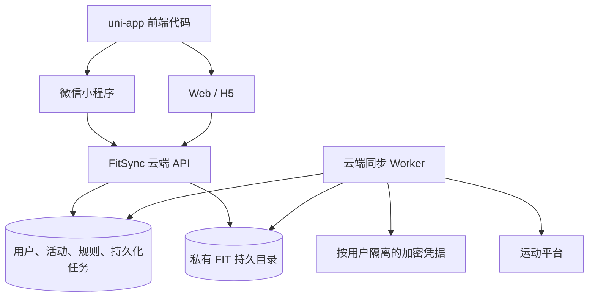

# FitSync 小程序与 Web 云同步方案

评估日期：2026-10-28。首版实现日期：2026-11-09。代码基线：`e7c6ce5`。开发分支：`codex/wechat-web`。

本分支已落地 Java 云端、共享 FIT 核心以及 uni-app 小程序 / Web 客户端，启动步骤见[云同步启动与部署](cloud-setup.md)。本地可运行和构建验证不代表真实平台账号、微信登录及广告已经获准并联调通过。

## 首版实施进度

| 范围 | 当前状态 |
| --- | --- |
| Java 21 / Spring Boot 服务 | 已实现会话鉴权、用户隔离、加密平台凭据、FIT 导入导出、云端多平台去重拉取、跳过缓存、保留独立/合并候选复核与活动删除 |
| 后台同步 | 已实现持久化任务、账号租约、重试、上传结果未知时确认、自动规则和历史补齐 |
| 平台 | 已移植 COROS、iGPSPORT 中国站真实协议，并通过 HTTP stub 测试；新增迈金、行者、Garmin 中国站、Strava 网页会话连接器及加密会话存储，六平台均已通过 stub／集成测试；尚无真实账号验证 |
| H5 / 微信客户端 | 已实现概览、活动列表（已连接平台云端去重拉取、搜索筛选排序、轨迹、详情副本/分发/合并/删除）、账号、规则、任务、导入导出、网页授权确认码；两端另已实现用户名密码注册登录、微信绑定、补设/修改密码与昵称；两种构建产物均已生成 |
| 广告 | 已实现微信原生广告按配置显示，缺配置或加载失败时隐藏；激励发奖在可信验证接通前禁用 |
| 部署 | 本地 H2 文件库；生产 PostgreSQL 配置、Flyway 迁移、Docker Compose 和 Nginx 配置已提供 |
| 当前边界 | FIT 原件先使用私有持久磁盘，尚未适配对象存储；已支持待核对活动合并到候选及删除活动，尚无任意两活动手动合并或用户注销；微信真机、真实平台、生产 PostgreSQL 和 Docker 部署未实测 |

## 结论与已确认的方向

可行。目标是增加一条「微信小程序 + Web + 云端自动同步」产品线，适配个人主体起步、分享推广和广告变现。用户已确认可以增加云服务，并明确收入来自广告；首版按免费使用、广告收入设计。

这属于新增客户端和执行环境：Compose 界面需要重写，Room 和 WorkManager 需要由云端持久化及任务执行替代。现有 FIT 解析、去重规则、平台协议解析和上传确认机制有复用价值。Android 本机版与云端版分别说明各自的数据存储方式。

最先验证的技术问题是：平台是否允许并能稳定支持从云端登录、续期、下载和上传。界面能运行不代表跨平台自动同步已经可用。

## 推荐架构

前端建议使用 uni-app、Vue 3 和 TypeScript，分别构建微信小程序和响应式 H5。uni-app 官方支持这两种发布目标；文件、登录、广告和地图仍需逐端适配。[uni-app 官方介绍](https://uniapp.dcloud.net.cn/)

服务端采用 **Java 21 + Spring Boot 3.5.16**，用户接口、平台账号管理、同步编排与持久化任务用 Java 实现。生产配置使用 PostgreSQL 存业务状态；首版 FIT 保存在私有持久目录，后续扩展对象存储适配。初期采用单体服务与数据库任务表，按实际负载再决定是否拆分独立队列服务。Java 21 满足框架要求。[Spring Boot 系统要求](https://docs.spring.io/spring-boot/3.5/system-requirements.html)

现有 Kotlin 算法可先抽成不依赖 Android 的 JVM 库，通过面向 Java 的接口供后端调用；Java 调用 Kotlin 有官方互操作支持。新后端业务代码使用 Java，算法复用与后续移植分开实施；如采用全 Java 代码库，则依据现有测试逐步迁移解析和去重实现。[Kotlin 与 Java 互操作](https://kotlinlang.org/docs/java-to-kotlin-interop.html)

用户离开小程序或关闭网页后，云端 Worker 继续执行已授权的规则与任务。前端负责提交操作、展示进度和提示重新授权，不承担常驻定时任务。

## 当前代码能复用什么

| 当前实现 | 迁移方式 | 依据 |
| --- | --- | --- |
| `FitEngine`、`FitCrc`、`FitQualityScorer`、`FitParseResult` | 先抽成可供 Java 调用的 JVM 核心模块，或按现有测试移植为 Java | 解析核心没有 Android API；文件与 ZIP 入口依赖 JVM |
| `ActivityFingerprint`、`DedupEngine` | 保留算法，用领域模型替换 Room 实体参数，再提供 Java 接口或迁移实现 | `DedupEngine` 当前直接依赖 `CanonicalActivityEntity` |
| `CorosApi`、`IgpsportApi`、`GarminConnectApi`、`CorosOssSigner` 等协议辅助代码 | 经依赖核对后提取解析、请求构造和签名函数 | 不等于整个连接器可以直接在服务端运行；`org.json` 需显式提供 JVM 依赖 |
| `PlatformConnector`、`ConnectorResult` | Java 端实现对应接口及结果类型，延续能力矩阵和结果语义 | 保留成功、重复、处理中、需登录、需操作、重试与永久失败的区分 |
| `ImportService`、`DeliveryPlanner`、`SyncCoordinator` | 按已有业务顺序与状态机实现 Java 服务，重做存储及并发控制 | 当前依赖 Room、Android 文件系统和本机组装根 |
| `WebSessionManager`、`SecureSessionStore` | 新建云端会话与密钥管理实现 | 当前依赖 Android `CookieManager` 和 Keystore |
| Compose 页面、osmdroid、WorkManager | 分别实现前端页面、地图适配和云端调度 | 属于 Android 运行环境 |

代码入口：[FIT 解析](../app/src/main/java/com/fitsync/app/fit/FitEngine.kt)、[去重](../app/src/main/java/com/fitsync/app/domain/dedup/DedupEngine.kt)、[实体](../app/src/main/java/com/fitsync/app/data/db/entity/Entities.kt)、[连接器注册](../app/src/main/java/com/fitsync/app/connectors/ConnectorRegistry.kt)、[现有架构](architecture.md)。

提取或移植时复用已有 FIT、去重、同步窗口、副本写入和上传协议测试，建立同一输入在原实现与后端实现中的结果对照。首阶段不同时改写解析规则。Java 复用库需要明确暴露 DTO 与方法，并处理必要的 Kotlin 运行库依赖；Room、WebView、Keystore 及 Android 组件必须先替换，不能直接作为服务端依赖。

## 六个平台的迁移优先级

下面是基于代码的迁移判断，不是云端实测结论，也不代表平台已授予商业接入权限。当前 Android 的六个平台均已实现列表、下载和上传；其中五个平台标记为实验性，详见[现有能力矩阵](platform-capabilities.md)。

| 平台 | 现有认证方式 | 云端主要缺口 | 建议顺序 |
| --- | --- | --- | --- |
| COROS 中国站 | 账号密码 API 登录，令牌失效后重新登录 | 去除 Android 会话依赖；验证云端 IP 风控、续期和 OSS 上传 | 首批候选 |
| iGPSPORT 中国站 | 账号密码 API 登录，JWT 失效后重新登录 | 去除 Android 会话依赖；验证云端登录、文件下载和异步上传确认 | 首批候选 |
| 迈金 ONELAP | 网页 localStorage token／refresh token + Cookie | 需用户从浏览器导出会话；验证云端 IP、刷新与上传 | 已接入：网页会话导入 |
| 行者 | 网页 Cookie | 需用户从浏览器导出 Cookie；验证会话更新 | 已接入：网页会话导入 |
| Garmin Connect 中国站 | JWT_WEB、CSRF、SSO 会话 | 首次授权、二次验证、云端会话续期 | 已接入：网页会话导入，仅中国站 |
| Strava | 网页 Cookie、网页列表和上传 | 当前实现不是公开 OAuth API，需评估官方商用接入 | 已接入：网页会话导入 |

首个技术验证建议选择 **COROS ↔ iGPSPORT**，因为仓库已有不依赖网页交互的登录协议。若推广用户更需要迈金或 Garmin，应先验证对应授权入口，再调整首发平台。

已有协议不保证云端访问成功。只有真实账号验证通过、接入方式适合公开运营的平台，才列入首发自动同步能力。

当前实现采用“用户显式导入网页会话”：H5／小程序不读取第三方站点 Cookie，用户从浏览器开发者工具复制平台要求的会话字段，服务端只读探活成功后才加密保存。桌面 Chrome／Edge 可安装 FitSync 会话助手扩展，由扩展弹出平台官方登录窗口并在人工登录后自动读取 Cookie、提交会话；扩展不绕过验证码，也不保存平台 Cookie。该方案便于快速验证协议，但会话会过期，且自动方式仅限桌面浏览器；公开运营前应继续评估各平台官方授权与合作接入。

## 平台登录不能直接照搬

Android 能通过宿主 WebView 读取 Cookie、执行页面脚本；普通 H5 无法据此读取其他站点的 Cookie 或 localStorage。浏览器同源策略限制跨站脚本及存储访问，因此不能用「打开平台网站后自动抓取登录态」作为 Web 登录方案。[MDN 同源策略](https://developer.mozilla.org/en-US/docs/Web/Security/Defenses/Same-origin_policy)

小程序应使用自己的页面和云端 API。嵌入网页还涉及业务域名白名单，并不能提供 Android 的 CookieManager 能力；不把 `web-view` 容器作为基础架构。[uni-app web-view 文档](https://uniapp.dcloud.net.cn/component/web-view.html)

每个平台分别确认授权路径：有适合的官方授权时优先采用；使用现有账号密码协议时，明确告知用户凭据交由云端托管及用途。没有可行授权路径的平台先提供文件导入、导出或人工操作，不显示为自动连接成功。

COROS 和 iGPSPORT 的现有实现需要保存密码才能在令牌过期后自动重登。云端版必须让用户明确选择是否托管必要凭据；只托管令牌的模式在失效后暂停任务，提示重新登录。账号密码、Cookie 和令牌都加密保存，密钥与业务数据库分开管理，前端与日志不得获得持久化的明文凭据。

## 云端新增的关键设计

### 用户与数据隔离

现有数据库是单机单用户模型，不能把 Room 表结构原样放进多人服务端。

- 引入业务 `user_id`，活动、文件副本、账号、规则、任务和使用额度均归属具体用户。服务端从会话确定用户，不信任客户端提交的所有者 ID。
- 账号唯一约束从 `platform` 改为 `(user_id, platform)`；文件去重从全局 `fileSha256` 改为用户范围内唯一，避免跨用户复用和信息泄漏。
- 活动、副本、任务之间的关联同时验证所有权；后台 Worker、批量操作和删除流程执行同样检查。
- FIT 使用私有存储。导出时鉴权并签发短期下载地址；为用户提供解绑、删除与清理入口，规则停用及解绑后阻止后续自动投递。

### 持久化任务与防重复

- 延续「目标预拉取 → 来源拉取 → 导入去重 → 规划 → 投递 → 远端确认」顺序与 48 小时增量重叠窗口。
- 数据库保存游标、下一次运行时间、尝试次数和远端处理标记；任务执行采用领取、租约及崩溃恢复，防止多个实例同时处理同一账号。
- Android 的进程内 `Mutex` 不能作为云端并发保护；上传还需数据库唯一约束与账号级串行控制。
- 保留 `PlatformCopy` 和投递幂等约束。平台仅受理、返回临时 ID 或上传响应丢失时，先进入确认流程；不能简单重新 POST 文件。
- 登录失效转为待用户处理，限流进入退避。按用户和平台限制并发，避免大量账号同时触发同一平台的风控。

### 两端登录与文件入口

- 小程序登录映射到业务用户；平台账号授权与微信身份登录是两件事。
- Web 与小程序均支持用户名密码注册登录，账号跨端通用；密码仅保存 PBKDF2-HMAC-SHA256 加盐散列。已登录用户可在小程序绑定微信或补设密码，把一键登录、确认码登录和密码登录统一到同一业务用户。
- Web 可通过一次性登录码与小程序确认流程关联同一业务用户，具体交互需真机验证。登录码短期有效、一次使用，并绑定发起的浏览器会话；不预设个人主体已具备开放平台网站微信登录权限。
- Web 使用本地文件选择；微信端单独适配 `wx.chooseMessageFile`。不要假设 `uni.chooseFile` 同时支持微信端。[uni-app 文件 API 与兼容性](https://uniapp.dcloud.net.cn/api/media/file.html)
- 导入在服务端重新校验格式、大小和 CRC。文件扩展名和前端校验不能替代 FIT 校验；地图与曲线按需加载，不把完整原始 FIT 放入小程序缓存。

## 个人主体与广告变现

变现目标为微信小程序流量主广告收入。首版不安排会员购买、付费搬家、订单或支付接入。

腾讯公开培训资料提供了个人用户的结算说明，并曾列出累计用户量 >500 等准入条件。该资料为 2024 年版本；当前门槛、个人账号资格和可用广告组件，需要在实际小程序后台「推广 → 流量主」确认，不能把旧门槛当作 2026 年必然可开通的承诺。[腾讯小程序流量主开通与变现介绍](https://training.tencentads.com/uploads/202406/r7MJ9qKg_S05TAn.pdf)

### 首版广告位置

| 广告方式 | 建议场景 | 产品边界 |
| --- | --- | --- |
| 原生模板广告 | 概览内容下方、活动列表自然间隔、同步完成页下方 | 先少量接入，预留稳定位置；避开操作按钮，减少误触 |
| 用户自选的激励视频 | 获取额外历史回填次数或批量处理额度 | 明示观看后获得的具体额度，用户主动选择；取消或加载失败可返回正常流程 |
| 插屏广告 | 后续根据留存数据评估，在自然操作间隔展示 | 首版暂缓；登录、授权、导入和同步执行过程中不插入 |

上述广告形态和工具类激励场景可参考腾讯官方培训材料，实际接入采用账号获准的组件与当期规范。[广告位类型介绍](https://training.tencentads.com/uploads/202111/8Nn0jUds_KxlgZt.pdf)、[工具类激励场景参考](https://training.tencentads.com/uploads/202406/MdmftG8s_4BW7jO.pdf)

基础同步保持免费，额外批量额度作为可选激励。额度由服务端按用户、用途和有效期管理，结合平台可用校验能力及每日上限防止重复领取；不把客户端自报观看次数当作广告结算数据。已经授权并提交的云端任务不依赖用户持续停留或反复看广告。广告未开通、未填充或加载失败时，基础功能仍可使用。

### 回访与收益验证

云端自动同步本身不会产生小程序广告曝光。这是本项目广告模式的关键约束：用户连接成功后可能很少再打开页面，但平台请求、存储和任务处理仍会持续产生费用。

我的产品判断是，应通过有实际价值的活动汇总、同步结果、周/月报和活动详情提高回访，再观察广告收入。不要靠故意增加操作步骤、打断任务或诱导点击增加曝光。周/月报先作为后续假设，优先保证同步闭环可用。

用统一结算口径估算「广告收入 ≈ 可计费曝光数 ÷ 1000 × 开发者实际 eCPM」，并核对最终结算；实际经营结果用广告结算收入扣除云资源、接口维护与售后等成本。eCPM、填充率和人均曝光取真实后台数据，不预设每位用户或每天能赚固定金额。自动同步频率、批量规模和文件保留量都需要设置资源预算。

小程序广告组件与 H5 广告分别评估。Web 首版负责访问、操作和分享；如后续也要从网页广告获利，需要另选支持 H5 的广告接入，不能假设微信小程序广告位在浏览器直接可用。

## 分阶段交付与验收

| 阶段 | 交付内容 | 进入下一阶段的条件 |
| --- | --- | --- |
| 0：本次评估 | 独立分支、复用清单、架构、首版边界和广告变现假设 | 已完成文档评估；未执行云端实测 |
| 1：授权与云端协议验证 | 两个候选平台在测试云环境中登录、下载、上传和续期；核对个人小程序类目与流量主准入 | 真实账号走通，平台接入适合后续公开运营 |
| 2：云端最小闭环 | 用户隔离、FIT 导入、活动去重、手动投递、远端确认、持久化续跑 | 重复提交、上传结果未知、任务崩溃和跨用户访问场景验证通过 |
| 3：小程序与 H5 首版 | 两端共用 API，平台连接、活动列表、同步规则、任务状态、文件导入导出 | 小程序 Android/iOS 真机及 Web 验证；关闭前端后云任务继续 |
| 4：小范围试用与广告 | 邀请骑友、验证回访、达到准入条件后接入获准的广告位、核对结算 | 同步可靠性、广告收入、留存和维护成本支持继续投入 |

首版围绕一次完整流程：登录 FitSync → 连接已验证的平台 → 导入或拉取活动 → 选择目标 → 提交同步 → 查看远端确认 → 开启长期规则。活动详情先提供关键指标和必要轨迹，后续再丰富分析与分享卡片。

## 投入与推广判断

技术上值得做小范围验证。小程序和 H5 能降低安装门槛，广告模式仍需要承担凭据保管、用户支持、接口维护和云端运行成本。当前实验性网页及私有协议的可用性，需要在公开运营前验证。

现阶段不对完整六平台工期或云账单给确定报价。先完成两个平台的云端验证，再按实际登录成功率、每用户同步请求量、FIT 保留量及支持成本估算。成本项至少包括计算、数据库、对象存储与流量、域名和认证；广告收入以实际结算为准。

推广先邀请一小批真实骑友，记录从进入页面到第一次成功同步的流失点、常用平台组合、任务失败原因和回访率。开通广告后跟踪可计费曝光、填充率、实际 eCPM、激励完成率、结算收入及加入广告前后的留存变化；不把累计注册人数或后台任务数直接等同于广告收益。

下一步外部验证应完成真实微信登录、两个平台账号在云环境的同步和续期、生产 PostgreSQL 及广告位投放；验证结果决定公开试用时可承诺的能力。
